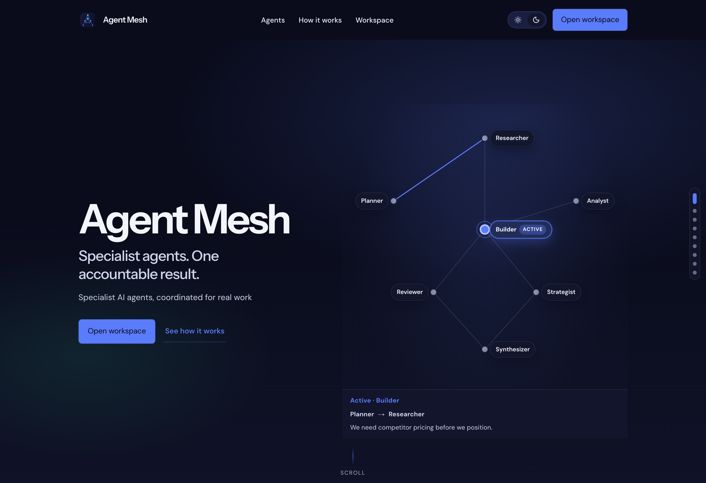
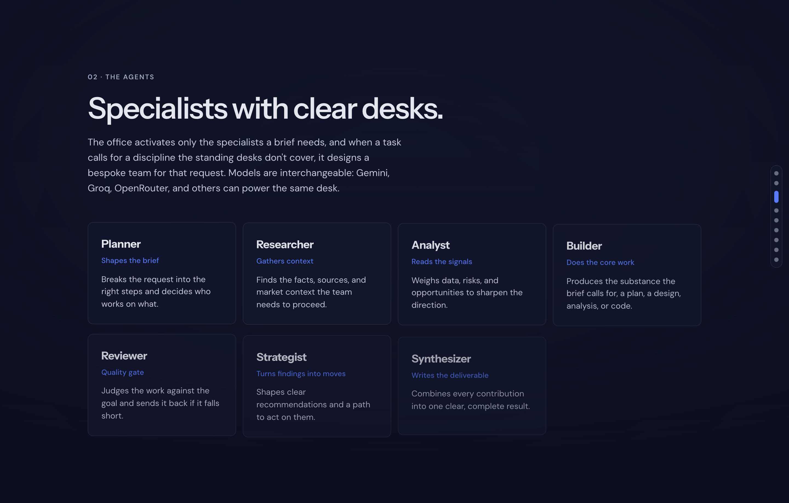
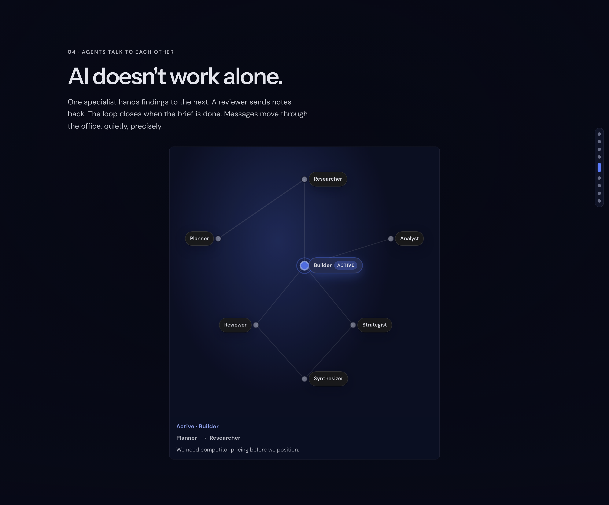
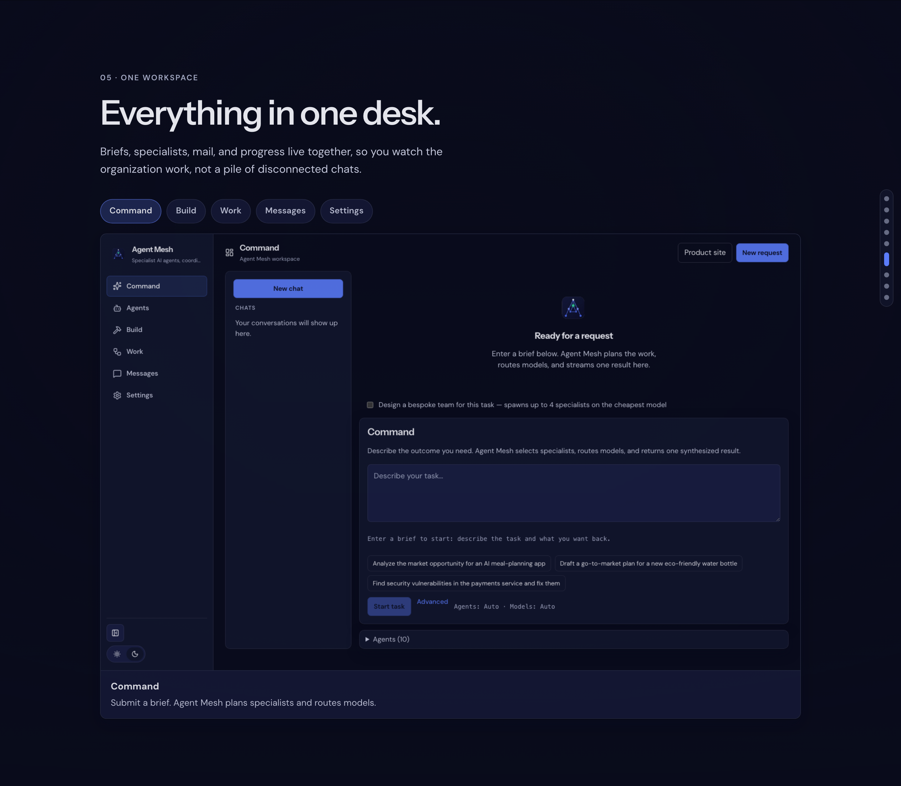
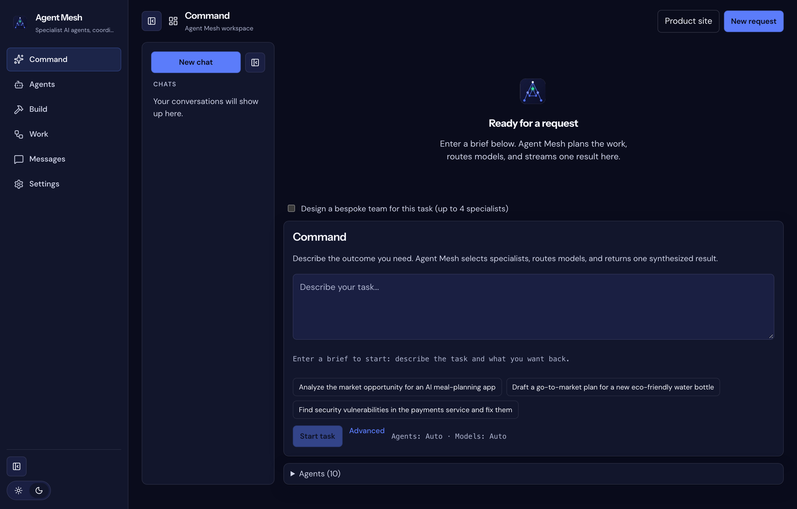
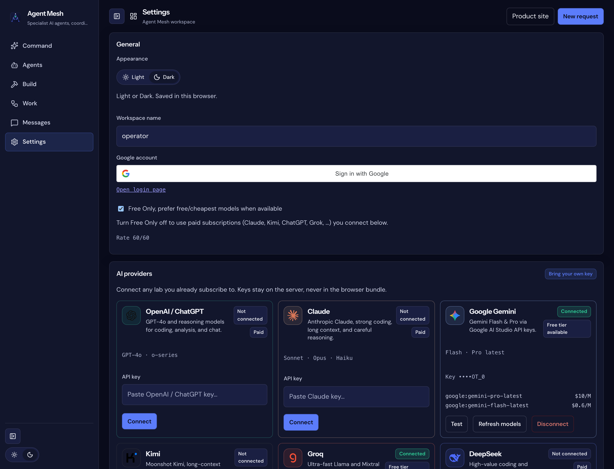
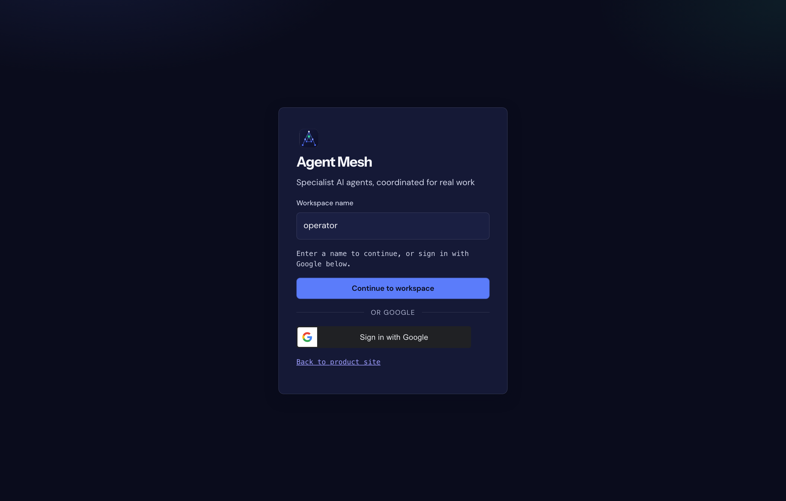

# Agent Mesh

Specialist AI agents, coordinated for real work.

Submit one brief. Agent Mesh selects the right specialists, builds a workflow, routes each step to a model provider, and returns a single synthesized result.

**Repository:** https://github.com/Sutej12/agent-mesh

**Wiki:** https://github.com/Sutej12/agent-mesh/wiki

**Pending uploads:** [`MISSING_SUBMISSION_FILES.md`](MISSING_SUBMISSION_FILES.md)  
**Audit checklist (Sprint 0–2):** [`docs/AUDIT_CHECKLIST_SPRINT0-2.md`](docs/AUDIT_CHECKLIST_SPRINT0-2.md)

## Deploy to Render (one click)

[](https://render.com/deploy?repo=https://github.com/Sutej12/agent-mesh)

The Blueprint provisions Redis (Key Value), the FastAPI backend, and the Next.js
frontend; Supabase supplies PostgreSQL and Google authentication. Render prompts for the
Supabase connection/project values. The app can still use its simulated AI provider until
you add a live provider key. Details: [docs/operations/render.md](docs/operations/render.md).

## Screenshots

<p align="center">
  
</p>

<p align="center">
  
</p>

<p align="center">
  
</p>

<p align="center">
  
</p>

<p align="center">
  
</p>

<p align="center">
  
</p>

<p align="center">
  
</p>

## Quick start (Docker)

```bash
cp .env.example .env
# Add the Supabase project, publishable key, and database connection values to .env.
# Normal Compose uses Supabase for durable state; it does not start local PostgreSQL.
docker compose up --build
```

| URL | Purpose |
|-----|---------|
| http://localhost:3000 | Product site |
| http://localhost:3000/login | Sign in |
| http://localhost:3000/office | Workspace |
| http://localhost:8000/docs | API reference |
| http://localhost:8000/healthz | Health check |

Stop with `Ctrl+C`, or run detached: `docker compose up --build -d`.

## Verified product scope (Sprint 0–2 MVP + polish)

Aligned with [`docs/AUDIT_CHECKLIST_SPRINT0-2.md`](docs/AUDIT_CHECKLIST_SPRINT0-2.md):

- Capability-based specialist selection and DAG planning
- Parallel / sequential execution with retries, skip, approve/reject, cancel/resume
- PostgreSQL-backed workflows; Redis for queues and rate limits
- Provider routing (Gemini, Groq, OpenAI, Claude, OpenRouter, …) + Free Only
- Workspace: Command, Build, Work, Messages, Agents, Settings
- Continuous Command chat (history stays in one thread; Enter to send)
- Clean markdown answers; downloadable files when the brief asks for a file
- Product site: section scroll flow, section motion, React Bits ambient backgrounds
- Google sign-in or local operator access for development
- CI: lint, types, pytest, Docker, gitleaks, Playwright smoke

## Configuration

Copy `.env.example` to `.env`. Important variables:

| Variable | Notes |
|----------|--------|
| `AUTH_MODE` | `header` for local development; `supabase` for production Supabase Auth |
| `DATABASE_URL` / `COMPOSE_DATABASE_URL` | Host/container Supabase PostgreSQL URL; use Direct or Session Pooler as appropriate |
| `DATABASE_SSL_MODE` | `disable` locally; `require` or preferably `verify-full` for Supabase |
| `SUPABASE_URL` | Backend Supabase project URL used to derive JWT issuer/JWKS |
| `NEXT_PUBLIC_SUPABASE_URL` | Browser-visible Supabase project URL |
| `NEXT_PUBLIC_SUPABASE_PUBLISHABLE_KEY` | Browser-safe Supabase publishable key; never use a secret/service-role key |
| `NEXT_PUBLIC_SITE_URL` | Canonical frontend origin used for the OAuth callback |
| `CORS_ALLOW_ORIGINS` | Your frontend origin(s), comma-separated |
| `*_API_KEY` | Provider keys (Groq, Google, OpenAI, …) |
| `ENVIRONMENT` | Use `production` when deploying |

Never commit `.env`.

## Deploy

1. Create a Supabase project and enable Google under Authentication providers.
2. Set `ENVIRONMENT=production`, a stable `ENCRYPTION_KEY`, and `AUTH_MODE=supabase`.
3. Configure `DATABASE_URL` with the Supabase Direct/Session Pooler URL and require TLS.
4. Configure `SUPABASE_URL`, `NEXT_PUBLIC_SUPABASE_URL`, and the publishable key.
5. Add `/auth/callback` for the local and production sites to Supabase's redirect allow-list.
6. In Google Cloud, point the OAuth redirect URI at Supabase's `/auth/v1/callback` URL.
7. Set `NEXT_PUBLIC_API_BASE_URL`, `NEXT_PUBLIC_SITE_URL`, and `CORS_ALLOW_ORIGINS`.
8. Run `alembic upgrade head` once before starting API replicas, then seed agents once.
9. Attach provider API keys or connect them in Settings after launch.

```bash
docker compose up --build -d
```

Production URL (when live): see pending row in [`MISSING_SUBMISSION_FILES.md`](MISSING_SUBMISSION_FILES.md).

## Docs & deliverables

| Doc | Link |
|-----|------|
| Wiki | [GitHub Wiki](https://github.com/Sutej12/agent-mesh/wiki) |
| Architecture | [`docs/architecture.md`](docs/architecture.md) |
| ADRs | [`docs/adr/`](docs/adr/) |
| Sprint 0–2 audit | [`docs/AUDIT_CHECKLIST_SPRINT0-2.md`](docs/AUDIT_CHECKLIST_SPRINT0-2.md) |
| Missing / pending files (ready links) | [`MISSING_SUBMISSION_FILES.md`](MISSING_SUBMISSION_FILES.md) |
| Technical paper (owner upload) | [`docs/paper/CS691_Technical_Paper.pdf`](docs/paper/CS691_Technical_Paper.pdf) |

Course remote is **read-only** reference only: https://github.com/htmw/F2026-T2-Phoenix

## Development

```bash
make install    # backend venv + frontend deps
make check      # lint, typecheck, tests
make up         # full stack
```

Frontend: Next.js App Router in `frontend/`  
Backend: FastAPI modular monolith in `backend/`

## License

Proprietary — all rights reserved unless otherwise noted.
